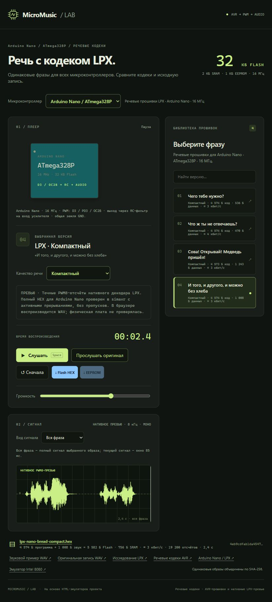

За **26 октября — 2 ноября** в [MicroMusic](https://witali.github.io/MicroMusic/) появилась общая страница речевых примеров: выбираете одну из четырёх фраз и микроконтроллер, слушаете результат, сравниваете с оригиналом и видите осциллограмму всей записи.
Для [Arduino Nano](https://witali.github.io/MicroMusic/web-player/?collection=hq4&device=atmega328p) подготовил **восемь готовых HEX-прошивок** — по компактному и более качественному LPX-варианту для каждой фразы, чтобы пример можно было скачать без самостоятельной сборки.

Все восемь прошивок проверены в simavr на полном воспроизведении при 8 кГц без пропусков; браузер проигрывает соответствующий WAV, а проверка на физической Nano ещё впереди.
В отдельной серии проверок LPX-плеера на ATmega328P удалось освободить **410–498 байт Flash** относительно прежнего варианта с диагностикой, сохранив точные выходные отсчёты в эмуляторе.

*Настоящий интерфейс плеера — откройте изображение, чтобы попробовать самому*

А для [ZX Spectrum в проекте ZX-video](https://github.com/Witali/ZX-video/tree/main/music-menu) сделал **загрузочную дискету с музыкальным меню**: на Spectrum 128 с Beta Disk можно выбрать «Люмьер» или «Алисию» клавишами либо мышью Kempston, переключать мелодии во время воспроизведения и останавливать звук пробелом.
Обе композиции заранее загружаются в память, поэтому переключение обходится без нового чтения дискеты; заодно исправил порядок записи регистров AY и сгладил переходы громкости.
Полное воспроизведение обеих мелодий и переключения проверены в Fuse, так что начать знакомство можно с эмулятора и [готового TRD-образа](https://github.com/Witali/ZX-video/blob/main/ZX-Music-Menu.trd).
