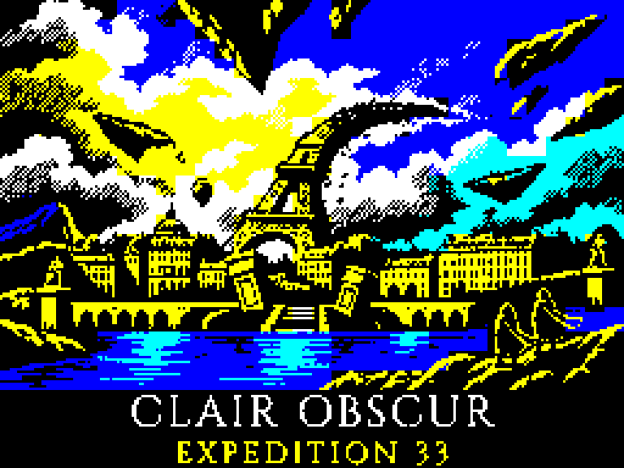

За **26 октября — 2 ноября** в [MicroMusic](https://witali.github.io/MicroMusic/) появилась общая страница речевых примеров: выбираете одну из четырёх фраз и микроконтроллер, слушаете результат, сравниваете с оригиналом и видите осциллограмму всей записи.
Для [Arduino Nano](https://witali.github.io/MicroMusic/web-player/?collection=hq4&device=atmega328p) подготовил **восемь готовых HEX-прошивок** — по компактному и более качественному LPX-варианту для каждой фразы, чтобы пример можно было скачать без самостоятельной сборки.

Все восемь прошивок проверены в simavr на полном воспроизведении при 8 кГц без пропусков; браузер проигрывает соответствующий WAV, а проверка на физической Nano ещё впереди.
В отдельной серии проверок LPX-плеера на ATmega328P удалось освободить **410–498 байт Flash** относительно прежнего варианта с диагностикой, сохранив точные выходные отсчёты в эмуляторе.

*Настоящий интерфейс плеера — откройте изображение, чтобы попробовать самому*

А для [ZX Spectrum в проекте ZX-video](https://github.com/Witali/ZX-video) сделал [**Expedition 33 Demo**](https://witali.github.io/ZX-video/?disk=Expedition-33-Demo.trd&renderer=webgl) — загрузочную дискету с **18 иллюстрациями в настоящем разрешении Spectrum** и полными AY-композициями «Люмьер» и «Алисия», которые играют по кругу.
Первая картинка остаётся на экране во время загрузки, затем начинается музыка и слайд-шоу с переходами в виде рассыпающихся лепестков; бордюр подстраивается под изображение.

Все данные заранее помещаются в память Spectrum 128, а меню появляется по нажатию любой клавиши, не прерывая музыку.
Обе мелодии целиком, смена картинок и возврат к началу проверены в Fuse без пропущенных музыкальных кадров.

*Заставка для экрана Spectrum 256×192 — нажмите, чтобы запустить демо*

Демо можно запустить в [онлайн-эмуляторе Spectrum 128](https://witali.github.io/ZX-video/?disk=Expedition-33-Demo.trd&renderer=webgl) и [скачать TRD-образ](https://witali.github.io/ZX-video/disks/Expedition-33-Demo.trd) кнопкой рядом с Play.
В каталоге оставил **132 образа**, убрав из списка старые шумные PDM-эксперименты, а в настройках по-прежнему доступны Canvas/WebGL и RC-фильтр звука на **5, 10, 15 или 20 кГц**.
