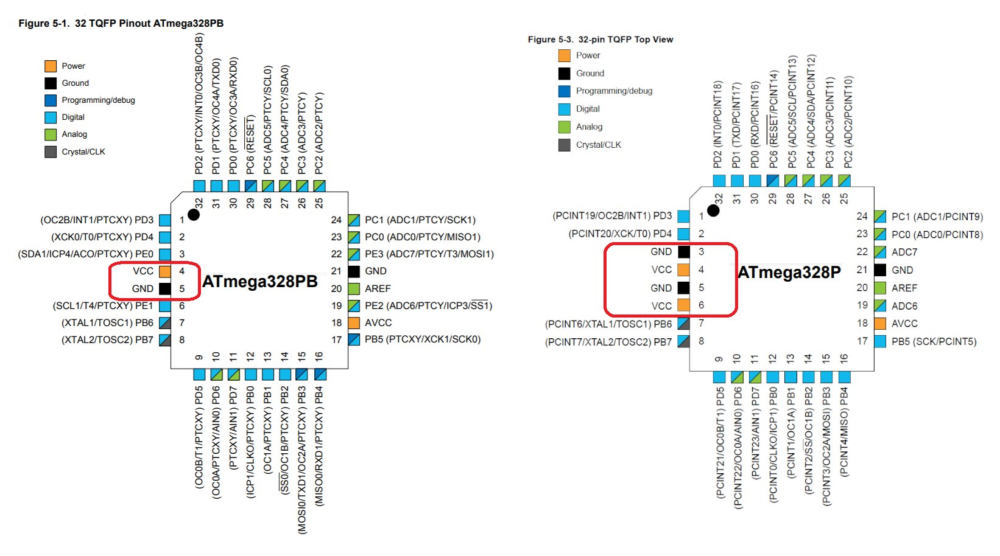

При проверке [моего модифицированного Optiboot](https://github.com/Witali/optiboot) в Arduino IDE столкнулся с неожиданностью: внешне обычная Nano оказалась платой с **ATmega328PB**, а стандартный профиль Nano ожидал другую микросхему и отказывался загружать скетч.

Моя версия — ассемблерная альтернатива [оригинальному Optiboot на C](https://github.com/Optiboot/optiboot), с общим генератором прошивок под разные AVR, частоты и размеры загрузочной области.
В Middle и Full есть чтение и запись EEPROM, тогда как в исходном C это отдельная, по умолчанию выключенная опция; добавлены проверки длины пакетов, адресов и защиты загрузочной области, а Full умеет читать реальные fuse- и lock-байты.

| Вариант | Резерв Flash под загрузчик | Что получает пользователь |
| --- | --- | --- |
| Mini | 256 байт на 14 подходящих ATmega | Запись и чтение Flash с проверкой результата; для ATmega328P/PB этот профиль недоступен |
| Middle | 512 байт на поддерживаемых ATmega | Flash, EEPROM и вызов сервиса записи Flash из приложения |
| Full | 1024 байта | Возможности Middle, чтение fuse/lock и дополнительные команды протокола |

У ATmega328PB [сигнатура `1E 95 16`, а у ATmega328P — `1E 95 0F`](https://onlinedocs.microchip.com/oxy/GUID-CBDC1838-0100-4F26-A45A-134958193C3B-en-US-4/GUID-5A8FB4BC-BC6B-47F2-AACE-6B6B107D5E8A.html), поэтому отказ при неверно выбранном процессоре закономерен.

[](/assets/posts/2026-11-09-atmega328p-vs-328pb.jpg)

*ATmega328PB слева, ATmega328P справа — иллюстрация из документации проекта, нажмите для увеличения*

Для поддержки PB добавил [адрес пакета MiniCore](https://mcudude.github.io/MiniCore/package_MCUdude_MiniCore_index.json) в **File → Preferences → Additional Boards Manager URLs**, затем открыл **Boards Manager**, нашёл **MiniCore от MCUdude** и установил пакет.

```text
https://mcudude.github.io/MiniCore/package_MCUdude_MiniCore_index.json
```

В **Tools** выбрал настройки моей платы из [добавленной в Optiboot инструкции](https://github.com/Witali/optiboot/blob/master/docs/arduino_nano_328pb_guide.md).

| Настройка | Значение |
| --- | --- |
| Board | MiniCore → ATmega328 |
| Variant | 328PB |
| Clock | External 16 MHz |
| Compiler LTO | Enabled |
| Bootloader | **No bootloader** |
| Baud rate | 115200 |
| Port | Порт подключённой Nano |

**Variant → 328PB** решает вопрос с выбором микросхемы, а **No bootloader** в моей конфигурации обходит отдельную ошибку `bootsize` при работе с загрузчиком, представляющимся как Optiboot 8.3.
Это настройка для платы с уже установленным моим загрузчиком: сам выбор пункта его не удаляет и не устанавливает, а **Burn Bootloader** — отдельная операция с программатором и фьюзами.
При этом MiniCore показывает все **32768 байт** Flash, но скетч должен помещаться ниже установленного загрузчика: **32256 байт для Middle** или **31744 байта для Full** на ATmega328PB.

Для прямой загрузки готового HEX через уже установленный Optiboot использую AVRDUDE с точным типом `m328pb`, Arduino-протоколом и скоростью 115200; в примере нужно подставить свой порт и файл скетча.

```sh
avrdude -c arduino -p m328pb -P PORT -b 115200 -D -U flash:w:sketch.hex:i
```
