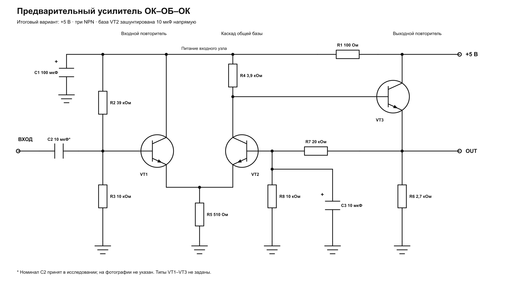

В [Power Amp](https://witali.github.io/power-amp/) оформил **предварительный усилитель на трёх NPN-транзисторах** с питанием **5 В**.
Каскады соединены по схеме **ОК–ОБ–ОК**: входной эмиттерный повторитель, усилительный каскад с общей базой и выходной эмиттерный повторитель.
В итоговом варианте база VT2 зашунтирована на землю конденсатором **10 мкФ напрямую**, без последовательного резистора, а цепь обратной связи **20 кОм / 10 кОм** сохранена.

Рассчитал рабочую точку, АЧХ, фазу и коэффициент нелинейных искажений в **ngspice 46** при 26,85 °C: обобщённая NPN-модель с β = 200, сопротивление источника 1 кОм, входной конденсатор 10 мкФ, без внешней нагрузки, с внутренним резистором на выходе 2,7 кОм.

| Параметр | Результат моделирования |
| --- | --- |
| Усиление на 1 кГц, от источника до выхода | 20,17 раза · 26,10 дБ |
| Ток питания | 1,995 мА |
| Напряжение покоя на выходе | 2,990 В |
| КНИ на 1 кГц при выходе 0,2 В пик | 0,351% |
| КНИ на 1 кГц при выходе 0,5 В пик | 1,539% |

По интерполяции расчётных точек КНИ достигает **1% при выходной амплитуде около 0,392 В пик**; в таблице тоже указаны пиковые амплитуды, а не размах или действующее значение.
Расчётная полоса по уровню −3 дБ относительно усиления на 1 кГц составила **23,85 Гц — 6,54 МГц**, но верхняя граница относится к модели без паразитных параметров монтажа и конденсаторов и требует проверки на реальных компонентах.
Результаты расчёта искажений проверил независимым дискретным преобразованием Фурье, а для уровней 0,2 и 0,5 В — ещё и уменьшением временного шага вдвое с увеличением времени установления.
Сохранил схему, netlist, графики и исходные данные расчётов; это результаты моделирования, работа физической сборки ими не подтверждена.
