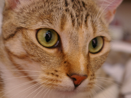
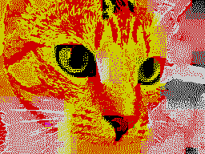
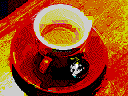
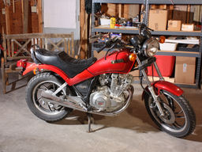
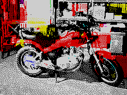

#### MicroMusic — меньше прошивки, тот же звук

За **11–17 ноября** в [MicroMusic](https://witali.github.io/MicroMusic/) уменьшил максимальный размер программы речевого плеера LPX для **ATtiny88 с 5409 до 3583 байт без аудиоданных** — на **1826 байт, примерно 34%**.
Универсальная ASM-сборка LPX v9 теперь занимает **3582–3583 Б на ATtiny88** и **3041–3042 Б на ATmega328/328P** без звука; с AVR-GCC 7.3.0 проверил по **22 нагрузки на каждом чипе в simavr 1.6 при 16 МГц и 8 кГц** — PWM совпал побитно, пропусков с IRQ не было.

Обновил и прошивки в [онлайн-плеере](https://witali.github.io/MicroMusic/web-player/): все **18 образов Tiny88 и Nano** используют универсальный v9, а размеры ниже включают звук; для девяти обновлённых Nano-образов все **203 762 PWM-отсчёта** совпали побитно, пропусков с IRQ в simavr не было.

| Прошивки со звуком | Было, Б | Стало, Б |
| --- | ---: | ---: |
| ATtiny88, 9 образов | — | 4032–5520 |
| ATmega328P, 8 отдельных записей | 4942–6418 | 3566–4998 |
| ATmega328P, диалог «Разговор у Совы» | 10 386 | 8946 |

---

#### ZX Spectrum — фотографии в 6912 байтах

В [ZX-video](https://witali.github.io/ZX-video/) добавил [конвертер фотографий в экран Spectrum](https://github.com/Witali/ZX-video/tree/codex/zx-neural-screen/toolkit/zx_neural): он создаёт настоящий **256×192 SCR-файл размером 6912 байт**, соблюдая ограничение двух цветов в каждой ячейке 8×8.
Сделал режимы пиксель-арта и контурного рисунка, доработал сохранение полутонов и тонких деталей, а также подавление ложных цветовых стыков между ячейками.

Ниже — три примера в режиме пиксель-арта: слева фото с тем же кадрированием, справа результат в формате экрана **256×192**.

| Фото: кот | После конвертации в Spectrum |
| --- | --- |
|  |  |

| Фото: чашка кофе | После конвертации в Spectrum |
| --- | --- |
|  |  |

| Фото: мотоцикл | После конвертации в Spectrum |
| --- | --- |
|  |  |

Фото: [кот и кофе — scikit-image, CC0](https://scikit-image.org/docs/0.25.x/api/skimage.data.html), [мотоцикл — Middlebury 2014](https://vision.middlebury.edu/stereo/data/); исходники открываются по нажатию на левую картинку, а SCR-файлы можно скачать для [кота](/assets/posts/2026-11-17-spectrum/chelsea.scr), [чашки кофе](/assets/posts/2026-11-17-spectrum/coffee.scr) и [мотоцикла](/assets/posts/2026-11-17-spectrum/motorcycle.scr).

---

#### AVR-Cookbook — приёмы оптимизации

Приёмы оптимизации собрал в новый [AVR-Cookbook](https://github.com/Witali/AVR-Cookbook/blob/main/README_ru.md) — **12 самостоятельных рецептов** с русской и английской документацией под лицензией MIT.
Внутри есть семь пар воспроизводимых сравнений для ATmega328P и ATtiny85: их можно собрать отдельно от остальных проектов и проверить затраты Flash, SRAM и тактов по сохранённой методике.
